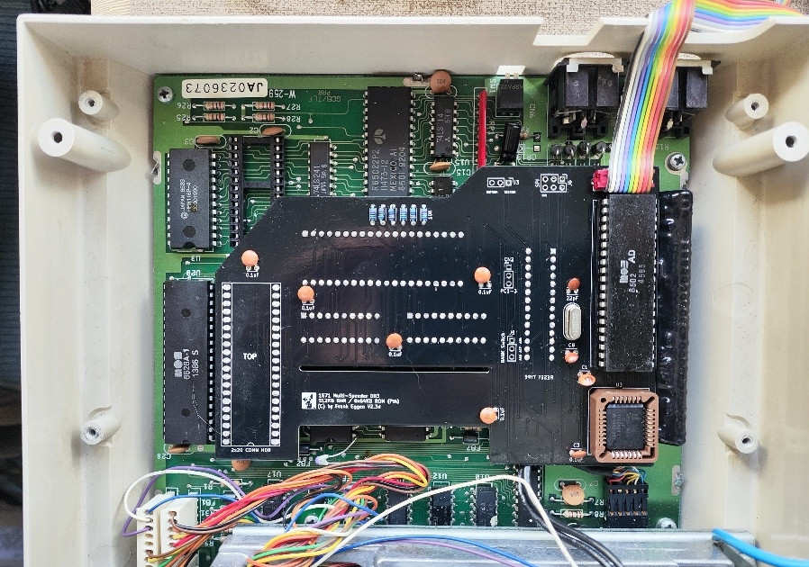
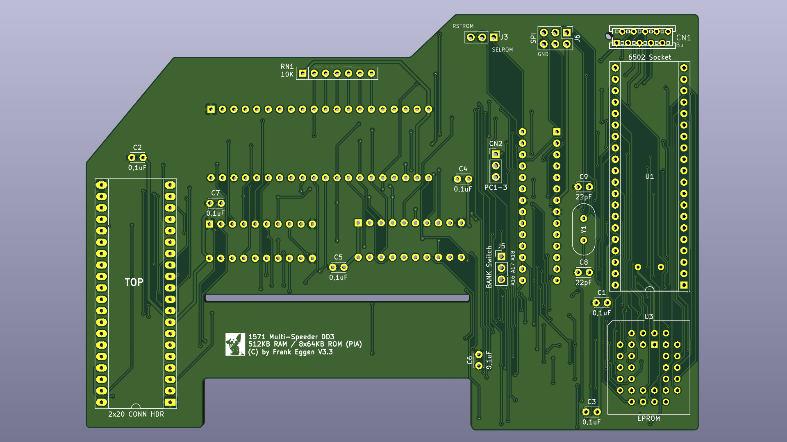
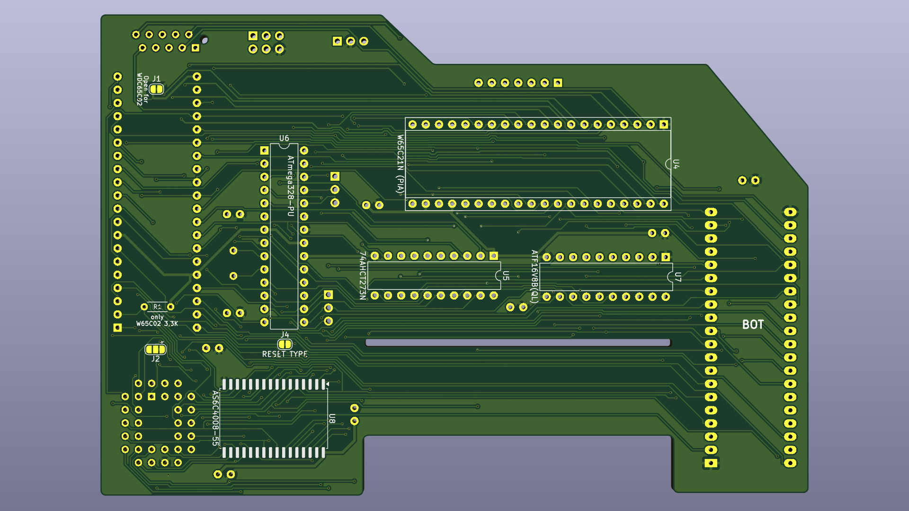
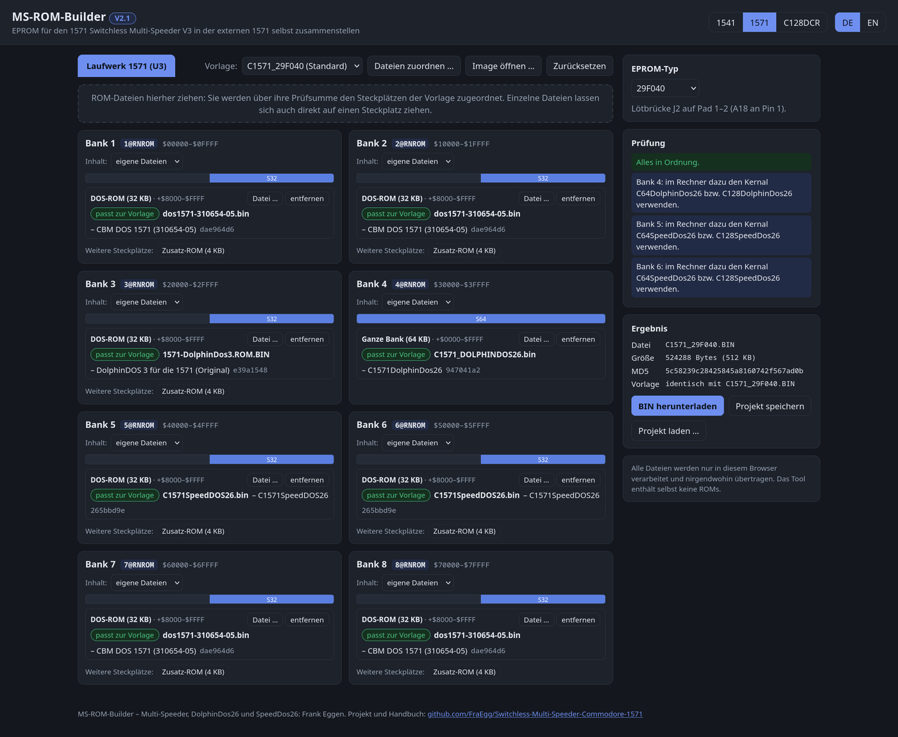
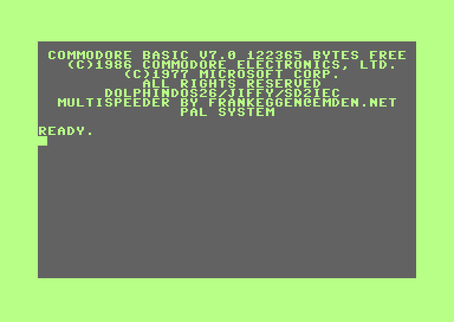

<p align="center"></p>

# Switchless 8x Multi-Floppy-Speeder V3 for the Commodore 1571

**512 KB flash EPROM and 512 KB RAM for the external Commodore 1571 floppy drive, with parallel port, DolphinDos26 and SpeedDos26.**

**Language:** [English](#english) · [Deutsch](#deutsch)

| | English | Deutsch |
|---|---|---|
| MS-ROM-Builder (browser tool for your own EPROM images) | [HTML](rom-builder/MS-ROM-Builder.html) | [HTML](rom-builder/MS-ROM-Builder.html) |
| 1571 Multi-Speeder V3 manual (hardware, parallel cable, C64/C128 kernals, build instructions, BOM) | [PDF](manuals/en/MultiSpeeder1571_Manual.pdf) | [PDF](manuals/de/MultiSpeeder1571_Handbuch.pdf) |
| DolphinDos26 manual (operation, commands, MS-Tools) | [DolphinDOS26](https://github.com/FraEgg/DolphinDOS) | [DolphinDOS26](https://github.com/FraEgg/DolphinDOS) |
| Interactive bill of materials (open in a browser) | [HTML](hardware/bom/v3.3_1571_CPU_THT_DD3_Multi-Speeder_512KB_DIP40-PIA_ibom.html) | [HTML](hardware/bom/v3.3_1571_CPU_THT_DD3_Multi-Speeder_512KB_DIP40-PIA_ibom.html) |

**Related projects:**

| Project | Repository |
|---|---|
| Multi-Speeder project: entry page with the basics on the Multi-Speeder V3, DolphinDos26, SpeedDos26 and accessories | [github.com/FraEgg/Switchless-Multi-Speeder-Project](https://github.com/FraEgg/Switchless-Multi-Speeder-Project) |
| DolphinDOS26: firmware, C64/C128 kernals, MS-Tools, manuals | [github.com/FraEgg/DolphinDOS](https://github.com/FraEgg/DolphinDOS) |
| Switchless 8x Multi-Floppy-Speeder for the C128DCR (internal 1571) | [github.com/FraEgg/Switchless-Multi-Speeder-Commodore-C128DCR-1571](https://github.com/FraEgg/Switchless-Multi-Speeder-Commodore-C128DCR-1571) |
| Switchless 8x Multi-Floppy-Speeder V3 for the 1541 | [github.com/FraEgg/Switchless-Multi-Speeder-Commodore-1541](https://github.com/FraEgg/Switchless-Multi-Speeder-Commodore-1541) |
| SpeedDos26: kernals for C64 and C128, firmware for 1541 and 1571, manual | [github.com/FraEgg/SpeedDOS](https://github.com/FraEgg/SpeedDOS) |

<p align="center"></p>

---

# English

## What is this?

The **1571 Switchless 8x Multi-Floppy-Speeder V3** speeds up the external **Commodore 1571** floppy drive. It is a single board that sits in the CPU socket of the 1571; the 6502 goes into the socket on the board. The parallel port is taken out of the drive with a cable to the user port of the C64 or C128.

- **8 DOS banks** of 64 KB in a 512 KB flash EPROM **29F040**, switched by DOS command without a switch (`@I:n@RNROM`)
- **512 KB RAM** in the drive, mapped as 64 banks of 8 KB at `$6000`–`$7FFF`
- a **PIA 6821/W65C21** as an 8-bit parallel port and for selecting the RAM banks
- RAMBoard-compatible for nibbler programs

With **DolphinDos26** for the 1571 and a **DolphinDos26 kernal** in the computer, the 1571 gets parallel transfer, track cache, whole disks in the drive RAM (`CDR`/`CDW`), a RAM disk (`CDM`), the MS-Addon-API and the MS-Tools – plus double-sided disks (`CDRD`/`CDWD`/`CDMD`).

Banks 5 and 6 of the EPROM template hold **SpeedDos26** for the external 1571, the revision of SpeedDOS+ – see [SpeedDos26](#speeddos26).

The board and the DOS banks are the same as on the [Multi-Speeder for the C128DCR](https://github.com/FraEgg/Switchless-Multi-Speeder-Commodore-C128DCR-1571): the same address decoder, the same microcontroller firmware, the same bank layout. Only the Commodore DOS differs – the external 1571 uses ROM 310654-05.

## Which files do I need?

| File | Goes into | Content |
|---|---|---|
| [`C1571_29F040.BIN`](rom/C1571_29F040.BIN) | EPROM U3 of the Multi-Speeder board (29F040, 512 KB) | template: original Commodore DOS 310654-05 (1571) in banks 1, 2, 7 and 8, original DolphinDOS 3 for the 1571 in bank 3, DolphinDos26 in bank 4, SpeedDos26 for the external 1571 in banks 5 and 6 |
| [`C1571_DOLPHINDOS26.bin`](rom/C1571_DOLPHINDOS26.bin) | EPROM U3, bank 4 (offset `$30000`) | DolphinDos26 for the 1571 (64 KB), for your own EPROM image |
| [`C64DolphinDos26.bin`](rom/C64DolphinDos26.bin) | kernal socket of the C64 | C64 kernal DolphinDos26 (8 KB) |
| [`C64IIDolphinDos26.bin`](rom/C64IIDolphinDos26.bin) | combined BASIC/kernal ROM of the C64 II, or ROM 251913 of the C128 (C64 mode) | C64 BASIC and kernal DolphinDos26 (16 KB) |
| [`C128DolphinDos26-US.BIN`](rom/C128DolphinDos26-US.BIN) | kernal ROM 318020 of the C128 | C128 kernal DolphinDos26 (16 KB, C128 mode), international and USA |
| [`C128DolphinDos26-DE.BIN`](rom/C128DolphinDos26-DE.BIN) | kernal ROM 318020 of the C128 | C128 kernal DolphinDos26 (16 KB, C128 mode) with the German DIN keyboard driver: the CAPS LOCK key is the ASCII/DIN key |
| [`C64SpeedDos26.bin`](rom/C64SpeedDos26.bin) | kernal socket of the C64 | C64 kernal SpeedDos26 (8 KB) |
| [`C64IISpeedDos26.bin`](rom/C64IISpeedDos26.bin) | combined BASIC/kernal ROM of the C64 II, or ROM 251913 of the C128 (C64 mode) | C64 BASIC and kernal SpeedDos26 (16 KB) |
| [`C128SpeedDos26-EN.bin`](rom/C128SpeedDos26-EN.bin) | kernal ROM 318020 of the C128 | C128 kernal SpeedDos26 (16 KB, C128 mode) with US keyboard |
| [`C128SpeedDos26-DE.bin`](rom/C128SpeedDos26-DE.bin) | kernal ROM 318020 of the C128 | C128 kernal SpeedDos26 (16 KB, C128 mode) with German keyboard (DIN) |
| [`ms-tools.d64`](ms-tools/ms-tools.d64) | disk | MS-Tools for testing (`MS-MEMTEST`) and copying, in C64 mode |
| [`hardware/gal`](hardware/gal) | GAL ATF16V8B (U7) | address decoder `ATF16V8_PAL_Adressendecoder_V3_0PIA_1571.jed` |
| [`hardware/atmega328p`](hardware/atmega328p) | ATmega328P (U6) | ROM switcher firmware (`.hex`), source (`.ino`), XGecu project (`.mpj`) |

The DolphinDos26 ROMs are the same as in the [DolphinDOS26](https://github.com/FraEgg/DolphinDOS) release. `C1571_29F040.BIN` is a ready-made template for the EPROM of the Multi-Speeder board: in banks 1, 2, 7 and 8 the 32 KB Commodore DOS, in bank 3 the 32 KB DolphinDOS 3 and in banks 5 and 6 the 32 KB SpeedDos26 ROM `C1571SpeedDOS26` sit in the upper half (bank start + `$8000`), the lower half is `$FF`; only bank 4 holds the complete 64 KB of DolphinDos26. Program it as it is, or replace single banks with other DOS versions. Banks 3 and 4 are identical to the C128DCR template.

| Command | EPROM offset | Bank content of `C1571_29F040.BIN` |
|---|---|---|
| `1@RNROM`, `2@RNROM` | `$00000`, `$10000` | Commodore DOS V3.0 1571 (310654-05) |
| `3@RNROM` | `$20000` | DolphinDOS 3 1571 (original) |
| `4@RNROM` | `$30000` | **C1571DolphinDos26** |
| `5@RNROM`, `6@RNROM` | `$40000`, `$50000` | **C1571SpeedDOS26** (SpeedDos26 for the external 1571) |
| `7@RNROM` | `$60000` | Commodore DOS V3.0 1571 (310654-05); recommended place for your own JiffyDOS ROM |
| `8@RNROM` | `$70000` | Commodore DOS V3.0 1571 (310654-05), free for further DOS versions |

**JiffyDOS:** JiffyDOS is not part of the project and is not contained in any template. If you own a licensed JiffyDOS ROM for the 1571, the best place for it is **bank 7** (`7@RNROM`): the 32 KB file goes into the upper half of the bank, from offset `$68000` of the image. Bank 8 is suitable as well. The easiest way is the MS-ROM-Builder (see below).

## SpeedDos26

**SpeedDos26** is a sub-project of the Multi-Speeder V3 and of DolphinDos26. It is a revision of the legendary firmware SpeedDOS+, so that it works better today with current hardware such as the SD2IEC. The template `C1571_29F040.BIN` holds the version for the external 1571 (`C1571SpeedDOS26`, 32 KB, based on the Commodore DOS 310654-05) in bank 5 and in bank 6; both banks contain the same drive ROM.

- Switch with `OPEN 1,8,15,"I:5@RNROM":CLOSE 1` (or `6@RNROM`). The drive reports `73,SPEEDDOS26   1571,00,00`.
- **Parallel cable:** SpeedDos26 transfers via the PIA 6821 of the Multi-Speeder at `$5000` – the same connector CN1 and the same cable as for DolphinDos26.
- **Kernal:** SpeedDos26 needs a SpeedDos26 kernal in the computer: [`C64SpeedDos26.bin`](rom/C64SpeedDos26.bin) (C64), [`C64IISpeedDos26.bin`](rom/C64IISpeedDos26.bin) (C64 II and C64 mode of the C128), for C128 mode [`C128SpeedDos26-DE.bin`](rom/C128SpeedDos26-DE.bin) (German keyboard, DIN) or [`C128SpeedDos26-EN.bin`](rom/C128SpeedDos26-EN.bin) (US keyboard). The kernals address SpeedDos26 drives in parallel, JiffyDOS drives and SD2IEC with JiffyDOS and all other devices serially. Loading shows `LOADING SD:` (parallel cable) or `LOADING JD:` (JiffyDOS); on the C128, burst takes precedence when loading if the drive is in 1571 mode (`LOADING BU:`).
- **Fast loader and file protection:** the fast loader is built into the ROM; `@T:NAME` toggles the protection of a file.
- **2 MHz:** when the drive detects a SpeedDos26 kernal on the parallel cable, it switches to 1571 mode (2 MHz, double-sided disks) by itself on the first access – on the C128, on the C64 and in the C64 mode of the C128. `@U0>M0` switches back to 1541 mode and locks the automatic switching until `@U0>M1` or a reset releases it again.

Details are in the [manual](manuals/en/MultiSpeeder1571_Manual.pdf), chapter 3.1, and in the SpeedDos26 manual of the SpeedDos26 project ([github.com/FraEgg/SpeedDOS](https://github.com/FraEgg/SpeedDOS)), chapter “SpeedDos26 for the 1571 and the C128”.

## Memory map of the drive

| Area | Use |
|---|---|
| `$0000`–`$07FF` | 2 KB RAM of the 1571 |
| `$1800`, `$1C00` | VIA 1 (serial bus), VIA 2 (drive control) |
| `$2000`–`$2FFF` | WD1770 (MFM) |
| `$3000`–`$3FFF` | EPROM: MS-Addon, API from `$3FFF` downwards (Multi-Speeder) |
| `$4000`–`$4FFF` | CIA 6526 (fast serial) |
| `$5000`–`$5FFF` | PIA 6821/W65C21: parallel port, RAM bank via PB0–PB5 (Multi-Speeder) |
| `$6000`–`$7FFF` | 8 KB window into the 512 KB SRAM, 64 banks (Multi-Speeder) |
| `$8000`–`$FFFF` | EPROM: DOS of the selected bank (Multi-Speeder) |

## Hardware

| Folder | Content |
|---|---|
| [`hardware/gerber`](hardware/gerber) | Gerber files V3.3 (two layers, with PCBWay position file) |
| [`hardware/schematics`](hardware/schematics) | Schematic and board drawing V3.3 as PDF |
| [`hardware/bom`](hardware/bom) | Bill of materials V3.3 (CSV, HTML, XLS) and interactive BOM (`_ibom.html`) |
| [`hardware/gal`](hardware/gal) | JED file, equations and diagram of the address decoder |
| [`hardware/atmega328p`](hardware/atmega328p) | Firmware of the microcontroller |

<p align="center">


</p>

| Part | Value | Task |
|---|---|---|
| U1 | DIP40 socket | the 6502 of the 1571 |
| U2 | 2×20 pin header (long pins) | plug into the CPU socket of the 1571 |
| U3 | 29F040 (alternatives 27C040, SST39SF040), PLCC32 socket | 8 DOS banks of 64 KB |
| U4 | W65C21N or 6821 (PIA) | parallel port PA0–PA7, CA1, CA2; RAM bank PB0–PB5 |
| U5 | 74AHCT273N | bank latch A16–A18 |
| U6 | ATmega328P-PU, crystal Y1 22.1184 MHz, C8/C9 22 pF | recognises `n@RNROM` and switches the bank |
| U7 | ATF16V8B(QL) | address decoder |
| U8 | AS6C4008-55 (SSOP32) | 512 KB SRAM |
| RN1 | 10 kΩ SIP7 | pull-ups |
| C1–C7 | 100 nF | decoupling |
| CN1 | Micro-MaTch, 10-way | parallel port to the user port of the computer |
| J3 ROM Select | 1×3 pin header | pin 1 SELROM, pin 2 GND, pin 3 RSTROM: briefly connecting pin 3 to GND resets to bank 1, pin 1 to GND advances one bank |
| J5 BANK Switch | 1×3 pin header | A16, A17, A18 for an optional kernal switcher |
| J6 SPI | 2×3 pin header | ISP connector for programming the ATmega on the board |
| CN2 | 1×3 pin header | free pins of the microcontroller (PC1–PC3), not used |
| J1 | solder jumper, closed | open only for a WDC 65C02 (then fit R1 3.3 kΩ) – DolphinDos26 needs the original NMOS 6502, J1 stays closed |
| J2 | solder jumper, three pads | EPROM type: 29F040 and SST39SF040 pad 1–2, 27C040 pad 2–3 |
| J4 RESET TYPE | solder jumper, closed | closed: the microcontroller resets the drive when switching (default) |

ATmega328P fuse bytes: low `0xFF`, high `0xDE`, extended `0xFD`, lock bits `0xCF`. When programming with the XGecu project file, do not program the EEPROM. The firmware runs unchanged with the 22.1184 MHz crystal. The complete bill of materials with DigiKey and Mouser links, the assembly order, the parallel cable pinout and the installation in the 1571 are in the [manual](manuals/en/MultiSpeeder1571_Manual.pdf), chapters 2, 8 and 9.

**Ordering the boards:** The boards can be made by any common PCB manufacturer from the Gerber files.

## MS-ROM-Builder (build your own EPROM images)

[`rom-builder/MS-ROM-Builder.html`](rom-builder/MS-ROM-Builder.html) is a browser tool for assembling the 512 KB EPROM image of the 1571 Multi-Speeder in the external 1571 yourself. Download the file and open it in a current browser – no installation, works offline on Windows, macOS and Linux, and the ROM files never leave your computer. The tool contains no ROMs. It is one tool for all three Multi-Speeder boards (1541, external 1571, C128DCR); choose **1571** at the top right.

- All eight banks with the slots of the 1571: whole bank (64 KB), DOS ROM `$8000`–`$FFFF` (32 KB) and extra ROM (4 KB). The template `C1571_29F040.BIN` is preset, with DolphinDos26 in bank 4 and SpeedDos26 in banks 5 and 6.
- Drop your ROM files in: they are assigned by their checksum, or placed directly onto a slot. Finished images can be opened, split into their parts and single banks replaced.
- Checks for missing, different or unknown ROMs, JiffyDOS content and reset vectors, and names the kernal that belongs to a bank. Shows solder jumper J2 for 29F040, SST39SF040 or 27C040.
- Download the finished 512 KB file with its MD5; save and load the layout as a small project file (no ROM data). German and English.

<p align="center"></p>

## Installation in short

1. Program the **29F040** for the Multi-Speeder board with the template `C1571_29F040.BIN` (Commodore DOS, DolphinDOS 3 in bank 3, DolphinDos26 in bank 4, SpeedDos26 in banks 5 and 6) or with your own image (alternatives: 27C040 or SST39SF040). Set solder jumper **J2** for the EPROM type.
2. Program GAL and ATmega (do not program the ATmega EEPROM).
3. Open the 1571, take out the 6502 (socket it first if it is soldered in) and **remove the DOS ROM** of the 1571 – the Multi-Speeder now supplies the DOS; a ROM left in place causes an address conflict.
4. Plug the Multi-Speeder board into the CPU socket, put the 6502 into socket U1 of the board.
5. Connect the parallel cable from CN1 to the user port of the computer (CN1 pin 1 CA2 → FLAG2, pins 2–9 PA0–PA7 → PB0–PB7, pin 10 CA1 ← PC2; manual chapter 2.4).
6. In the computer, fit a DolphinDos26 kernal: `C64DolphinDos26.bin` (C64), `C64IIDolphinDos26.bin` (C64 II), on the C128 `C128DolphinDos26-US.BIN` or `C128DolphinDos26-DE.BIN` plus `C64IIDolphinDos26.bin` for C64 mode. For SpeedDos26 (banks 5 and 6) use the SpeedDos26 kernals instead, see [SpeedDos26](#speeddos26).
7. Switch with `OPEN 1,8,15,"I:4@RNROM":CLOSE 1`. `@` reports `73,DOLPHINDOS26 1571,00,00`, loading shows `LOADING DD:`.
8. Test the RAM in C64 mode with `MS-MEMTEST` from the MS-Tools disk.

<p align="center"></p>

## Known limits

- C1571DolphinDos26 always runs at 2 MHz like the original DolphinDOS 3. Before programs with their own fast loader enter `@X-` (1 MHz), or switch to the Commodore ROM with `@I:1@RNROM`.
- At 2 MHz the microcontroller can miss a switching command; repeat it. A 22.1184 MHz crystal and a 74AHCT273 as U5 make switching reliable.
- DolphinDos26 needs the original NMOS 6502, not a WDC 65C02.
- MS-NIBCOPY detects the 1571 and loads its own drive code (1 MHz for disk access, 2 MHz for the transfer); it uses the index hole sensor of the 1571, so every track of the copy keeps the same position relative to the index hole as on the original. MS-15SECCOPY itself sets a 1571 with DolphinDOS to 1 MHz with `X-` for BACKUP and VERIFY and back to 2 MHz with `X+` afterwards; with SpeedDos26 it uses `U0>M0` and `U0>M1`.

## What is in this repository?

```
manuals/en, de   1571 Multi-Speeder V3 manual as PDF
rom/             DolphinDos26 ROMs for the 1571, the C64 and the C128 (C128 and C64 mode),
                 SpeedDos26 kernals for the C64 and the C128,
                 EPROM template C1571_29F040.BIN (drive)
ms-tools/        ms-tools.d64
rom-builder/     MS-ROM-Builder: browser tool for your own EPROM images
hardware/        Gerber, schematics, BOM, GAL and ATmega files (V3.3)
assets/          Images for this page
tools/           Maintenance scripts for this repository (make_eprom_1571.py, update_release.py)
CHECKSUMS.*      MD5 and SHA-256 of all published files
```

Apart from the template `C1571_29F040.BIN` (Commodore DOS 310654-05, DolphinDOS 3, DolphinDos26 and SpeedDos26), no EPROM image is included. JiffyDOS is commercial software and not part of this project; a licence is available from [RETRO Innovations](https://www.jiffydos.com). The C64 and C128 kernals contain JiffyDOS transfer routines – see [JiffyDOS licence: please check](#jiffydos-licence-please-check).

Verify your download with `sha256sum -c CHECKSUMS.sha256` or `md5sum -c CHECKSUMS.md5`.

## JiffyDOS licence: please check

The C64 kernals [`C64DolphinDos26.bin`](rom/C64DolphinDos26.bin) and [`C64IIDolphinDos26.bin`](rom/C64IIDolphinDos26.bin) and the C128 kernals [`C128DolphinDos26-US.BIN`](rom/C128DolphinDos26-US.BIN) and [`C128DolphinDos26-DE.BIN`](rom/C128DolphinDos26-DE.BIN) contain JiffyDOS transfer routines that are instruction-identical to a JiffyDOS kernal (C64: JiffyDOS sd2iec kernal, C128: JiffyDOS C128 kernal). The same applies to the SpeedDos26 kernals [`C64SpeedDos26.bin`](rom/C64SpeedDos26.bin), [`C64IISpeedDos26.bin`](rom/C64IISpeedDos26.bin), [`C128SpeedDos26-DE.bin`](rom/C128SpeedDos26-DE.bin) and [`C128SpeedDos26-EN.bin`](rom/C128SpeedDos26-EN.bin): they contain the same transfer routines. The drive template `C1571_29F040.BIN` and the JiffyDOS drive firmware are free of JiffyDOS code; the latter is not included. Jim Brain of RETRO Innovations, which holds the JiffyDOS licence rights, confirmed that publishing the DolphinDos26 kernals on GitHub is fine; this includes the SpeedDos26 kernals. As he describes it, code that implements the same transfer behaviour without being an exact copy needs no licence. If the transfer code is the same, as it is here, he believes the end user would need one.

**Please check for yourself whether your use calls for an official JiffyDOS licence:** <https://www.jiffydos.com>

Details: [DolphinDOS26 – JiffyDOS licence](https://github.com/FraEgg/DolphinDOS#jiffydos-licence-please-check).

## Credits

| Who | What |
|---|---|
| Günther Jilg, Jan Bubela (Dolphin Software) | DolphinDOS 3.0, the base of DolphinDos26 |
| Oliver Eikemeier, Oliver Joppich (1984); manufactured and sold by Elektronik Service – Christoph Dichte | SpeedDOS and SpeedDOS+, the base of SpeedDos26 |
| Per Bengtsson (RetroNynjah) | [Switchless Multi-ROM](https://github.com/RetroNynjah/Switchless-Multi-ROM-for-27128-27256), the ROM switcher sketch |
| Jim Drew, Joeri van Haren | Help and review of the hardware (V2.1) |
| silverdr | [Technical documentation on DolphinDOS 3](https://e4aws.silverdr.com/projects/dolphindos3/) |
| ytmytm | [1571 TrackCache ROM patch](https://github.com/ytmytm/1571-TrackCacheROM) |
| Stefan Kauf | Support with the idea of the Multi-Speeder |
| Mark Fellows / Creative Micro Designs; Jim Brain, RETRO Innovations | JiffyDOS |

**Special thanks to Jim Brain of RETRO Innovations** for his support with the JiffyDOS implementation of the DolphinDos26 and SpeedDos26 kernals.

Multi-Speeder, DolphinDos26, SpeedDos26 and the manuals: **Frank Eggen**. If you would like to support the project: [donation via PayPal](https://www.paypal.com/donate/?cmd=_s-xclick&hosted_button_id=Q8HXKYARXKT4L&ssrt=1714757590172).

## Licence

Free for private, non-commercial use. No sale and no commercial use (boards, kits, ROM files, programmed EPROMs) without consulting the developer. Private hobby project without any warranty; building and installation at your own risk. Details: [LICENSE.md](LICENSE.md).

---

# Deutsch

## Was ist das?

Der **1571 Switchless 8x Multi-Floppy-Speeder V3** beschleunigt das externe Diskettenlaufwerk **Commodore 1571**. Er besteht aus einer Platine, die im CPU-Sockel der 1571 sitzt; die 6502 kommt in den Sockel auf der Platine. Der Parallelport wird mit einem Kabel aus dem Laufwerk zum Userport des C64 oder C128 geführt.

- **8 DOS-Bänke** zu 64 KB in einem 512-KB-Flash-EPROM **29F040**, umgeschaltet per DOS-Befehl ohne Schalter (`@I:n@RNROM`)
- **512 KB RAM** im Laufwerk, eingeblendet als 64 Bänke zu 8 KB bei `$6000`–`$7FFF`
- ein **PIA 6821/W65C21** als 8-Bit-Parallelport und zur Wahl der RAM-Bank
- RAMBoard-kompatibel für Nibbler-Programme

Mit **DolphinDos26** für die 1571 und einem **DolphinDos26-Kernal** im Rechner bietet die 1571 Parallelübertragung, Track-Cache, ganze Disketten im Laufwerks-RAM (`CDR`/`CDW`), eine RAM-Disk (`CDM`), die MS-Addon-API und die MS-Tools – dazu doppelseitige Disketten (`CDRD`/`CDWD`/`CDMD`).

In Bank 5 und 6 der EPROM-Vorlage liegt **SpeedDos26** für die externe 1571, die Überarbeitung von SpeedDOS+ – siehe [SpeedDos26](#speeddos26-1).

Platine und DOS-Bänke entsprechen dem [Multi-Speeder für den C128DCR](https://github.com/FraEgg/Switchless-Multi-Speeder-Commodore-C128DCR-1571): derselbe Adressdecoder, dieselbe Firmware des Mikrocontrollers, dieselbe Bankbelegung. Nur das Commodore-DOS ist ein anderes – die externe 1571 verwendet das ROM 310654-05.

## Welche Dateien brauche ich?

| Datei | Kommt in | Inhalt |
|---|---|---|
| [`C1571_29F040.BIN`](rom/C1571_29F040.BIN) | EPROM U3 der Multi-Speeder-Platine (29F040, 512 KB) | Vorlage: originales Commodore-DOS 310654-05 (1571) in den Bänken 1, 2, 7 und 8, originales DolphinDOS 3 für die 1571 in Bank 3, DolphinDos26 in Bank 4, SpeedDos26 für die externe 1571 in Bank 5 und 6 |
| [`C1571_DOLPHINDOS26.bin`](rom/C1571_DOLPHINDOS26.bin) | EPROM U3, Bank 4 (Offset `$30000`) | DolphinDos26 für die 1571 (64 KB), für ein eigenes EPROM-Abbild |
| [`C64DolphinDos26.bin`](rom/C64DolphinDos26.bin) | Kernal-Sockel des C64 | C64-Kernal DolphinDos26 (8 KB) |
| [`C64IIDolphinDos26.bin`](rom/C64IIDolphinDos26.bin) | kombiniertes BASIC-/Kernal-ROM des C64 II oder ROM 251913 des C128 (C64-Modus) | C64-BASIC und -Kernal DolphinDos26 (16 KB) |
| [`C128DolphinDos26-US.BIN`](rom/C128DolphinDos26-US.BIN) | Kernal-ROM 318020 des C128 | C128-Kernal DolphinDos26 (16 KB, C128-Modus), international und USA |
| [`C128DolphinDos26-DE.BIN`](rom/C128DolphinDos26-DE.BIN) | Kernal-ROM 318020 des C128 | C128-Kernal DolphinDos26 (16 KB, C128-Modus) mit deutschem DIN-Tastaturtreiber: Die CAPS-LOCK-Taste ist die ASCII/DIN-Taste |
| [`C64SpeedDos26.bin`](rom/C64SpeedDos26.bin) | Kernal-Sockel des C64 | C64-Kernal SpeedDos26 (8 KB) |
| [`C64IISpeedDos26.bin`](rom/C64IISpeedDos26.bin) | kombiniertes BASIC-/Kernal-ROM des C64 II oder ROM 251913 des C128 (C64-Modus) | C64-BASIC und -Kernal SpeedDos26 (16 KB) |
| [`C128SpeedDos26-EN.bin`](rom/C128SpeedDos26-EN.bin) | Kernal-ROM 318020 des C128 | C128-Kernal SpeedDos26 (16 KB, C128-Modus) mit US-Tastatur |
| [`C128SpeedDos26-DE.bin`](rom/C128SpeedDos26-DE.bin) | Kernal-ROM 318020 des C128 | C128-Kernal SpeedDos26 (16 KB, C128-Modus) mit deutscher Tastatur (DIN) |
| [`ms-tools.d64`](ms-tools/ms-tools.d64) | Diskette | MS-Tools zum Testen (`MS-MEMTEST`) und Kopieren, im C64-Modus |
| [`hardware/gal`](hardware/gal) | GAL ATF16V8B (U7) | Adressdecoder `ATF16V8_PAL_Adressendecoder_V3_0PIA_1571.jed` |
| [`hardware/atmega328p`](hardware/atmega328p) | ATmega328P (U6) | Firmware des ROM-Umschalters (`.hex`), Quelltext (`.ino`), XGecu-Projekt (`.mpj`) |

Die DolphinDos26-ROMs sind dieselben wie im Release von [DolphinDOS26](https://github.com/FraEgg/DolphinDOS). `C1571_29F040.BIN` ist eine fertige Vorlage für das EPROM der Multi-Speeder-Platine: In den Bänken 1, 2, 7 und 8 liegt das 32 KB große Commodore-DOS, in Bank 3 das 32 KB große DolphinDOS 3 und in Bank 5 und 6 das 32 KB große SpeedDos26-ROM `C1571SpeedDOS26` in der oberen Hälfte (Bankanfang + `$8000`), die untere Hälfte ist `$FF`; nur Bank 4 enthält die vollen 64 KB von DolphinDos26. Sie kann direkt gebrannt werden, einzelne Bänke lassen sich durch andere DOS-Versionen ersetzen. Bank 3 und 4 sind identisch mit der Vorlage des C128DCR.

| Befehl | EPROM-Offset | Bankinhalt von `C1571_29F040.BIN` |
|---|---|---|
| `1@RNROM`, `2@RNROM` | `$00000`, `$10000` | Commodore DOS V3.0 1571 (310654-05) |
| `3@RNROM` | `$20000` | DolphinDOS 3 1571 (Original) |
| `4@RNROM` | `$30000` | **C1571DolphinDos26** |
| `5@RNROM`, `6@RNROM` | `$40000`, `$50000` | **C1571SpeedDOS26** (SpeedDos26 für die externe 1571) |
| `7@RNROM` | `$60000` | Commodore DOS V3.0 1571 (310654-05); Empfehlung: Platz für ein eigenes JiffyDOS-ROM |
| `8@RNROM` | `$70000` | Commodore DOS V3.0 1571 (310654-05), frei für weitere DOS-Versionen |

**JiffyDOS:** JiffyDOS gehört nicht zum Projekt und ist in keiner Vorlage enthalten. Wer ein eigenes, lizenziertes JiffyDOS-ROM für die 1571 besitzt, legt es am besten in **Bank 7** (`7@RNROM`): die 32-KB-Datei kommt in die obere Hälfte der Bank, ab Offset `$68000` des Abbilds. Bank 8 eignet sich ebenso. Am einfachsten geht das mit dem MS-ROM-Builder (siehe unten).

## SpeedDos26

**SpeedDos26** ist ein Unterprojekt des Multi-Speeder V3 und von DolphinDos26. Es ist eine Überarbeitung der legendären Firmware SpeedDOS+, damit sie heute besser mit aktueller Hardware wie dem SD2IEC zusammenarbeitet. In der Vorlage `C1571_29F040.BIN` liegt die Fassung für die externe 1571 (`C1571SpeedDOS26`, 32 KB, Grundlage ist das Commodore-DOS 310654-05) in Bank 5 und in Bank 6; beide Bänke enthalten dasselbe Laufwerks-ROM.

- Umschalten mit `OPEN 1,8,15,"I:5@RNROM":CLOSE 1` (oder `6@RNROM`). Das Laufwerk meldet sich mit `73,SPEEDDOS26   1571,00,00`.
- **Parallelkabel:** SpeedDos26 überträgt über den PIA 6821 des Multi-Speeders bei `$5000` – derselbe Anschluss CN1 und dasselbe Kabel wie für DolphinDos26.
- **Kernal:** Zu SpeedDos26 gehört ein SpeedDos26-Kernal im Rechner: [`C64SpeedDos26.bin`](rom/C64SpeedDos26.bin) (C64), [`C64IISpeedDos26.bin`](rom/C64IISpeedDos26.bin) (C64 II und C64-Modus des C128), für den C128-Modus [`C128SpeedDos26-DE.bin`](rom/C128SpeedDos26-DE.bin) (deutsche Tastatur, DIN) oder [`C128SpeedDos26-EN.bin`](rom/C128SpeedDos26-EN.bin) (US-Tastatur). Die Kernals sprechen SpeedDos26-Laufwerke parallel, JiffyDOS-Laufwerke und SD2IEC mit JiffyDOS und alle anderen Geräte seriell an. Beim Laden erscheint `LOADING SD:` (Parallelkabel) oder `LOADING JD:` (JiffyDOS); am C128 hat Burst beim Laden Vorrang, wenn das Laufwerk im 1571-Modus ist (`LOADING BU:`).
- **Schnelllader und Dateischutz:** Der Schnelllader ist fest im ROM; `@T:NAME` schaltet den Dateischutz einer Datei um.
- **2 MHz:** Erkennt das Laufwerk einen SpeedDos26-Kernal am Parallelkabel, schaltet es beim ersten Zugriff selbst in den 1571-Modus (2 MHz, doppelseitige Disketten) – am C128, am C64 und im C64-Modus des C128. `@U0>M0` schaltet in den 1541-Modus zurück und sperrt das automatische Umschalten, bis `@U0>M1` oder ein Reset es wieder freigibt.

Einzelheiten stehen im [Handbuch](manuals/de/MultiSpeeder1571_Handbuch.pdf), Kapitel 3.1, und im Handbuch SpeedDos26 des Projekts SpeedDos26 ([github.com/FraEgg/SpeedDOS](https://github.com/FraEgg/SpeedDOS)), Kapitel „SpeedDos26 für 1571 und C128“.

## Speicherbelegung des Laufwerks

| Bereich | Belegung |
|---|---|
| `$0000`–`$07FF` | 2 KB RAM der 1571 |
| `$1800`, `$1C00` | VIA 1 (serieller Bus), VIA 2 (Laufwerkssteuerung) |
| `$2000`–`$2FFF` | WD1770 (MFM) |
| `$3000`–`$3FFF` | EPROM: MS-Addon, API ab `$3FFF` abwärts (Multi-Speeder) |
| `$4000`–`$4FFF` | CIA 6526 (schneller serieller Bus) |
| `$5000`–`$5FFF` | PIA 6821/W65C21: Parallelport, RAM-Bank über PB0–PB5 (Multi-Speeder) |
| `$6000`–`$7FFF` | 8-KB-Fenster ins 512-KB-SRAM, 64 Bänke (Multi-Speeder) |
| `$8000`–`$FFFF` | EPROM: DOS der gewählten Bank (Multi-Speeder) |

## Hardware

| Ordner | Inhalt |
|---|---|
| [`hardware/gerber`](hardware/gerber) | Gerber-Dateien V3.3 (zwei Lagen, mit Bestückungsdatei für PCBWay) |
| [`hardware/schematics`](hardware/schematics) | Schaltplan und Platinenzeichnung V3.3 als PDF |
| [`hardware/bom`](hardware/bom) | Stückliste V3.3 (CSV, HTML, XLS) und interaktive Stückliste (`_ibom.html`) |
| [`hardware/gal`](hardware/gal) | JED-Datei, Gleichungen und Diagramm des Adressdecoders |
| [`hardware/atmega328p`](hardware/atmega328p) | Firmware des Mikrocontrollers |

| Bauteil | Wert | Aufgabe |
|---|---|---|
| U1 | DIP40-Sockel | die 6502 der 1571 |
| U2 | 2×20-Stiftleiste (lange Stifte) | steckt im CPU-Sockel der 1571 |
| U3 | 29F040 (alternativ 27C040, SST39SF040), PLCC32-Sockel | 8 DOS-Bänke zu 64 KB |
| U4 | W65C21N oder 6821 (PIA) | Parallelport PA0–PA7, CA1, CA2; RAM-Bank PB0–PB5 |
| U5 | 74AHCT273N | Bank-Latch A16–A18 |
| U6 | ATmega328P-PU, Quarz Y1 22,1184 MHz, C8/C9 22 pF | erkennt `n@RNROM` und schaltet die Bank |
| U7 | ATF16V8B(QL) | Adressdecoder |
| U8 | AS6C4008-55 (SSOP32) | 512-KB-SRAM |
| RN1 | 10 kΩ SIP7 | Pull-ups |
| C1–C7 | 100 nF | Abblockkondensatoren |
| CN1 | Micro-MaTch, 10-polig | Parallelport zum Userport des Rechners |
| J3 ROM Select | Stiftleiste 1×3 | Pin 1 SELROM, Pin 2 GND, Pin 3 RSTROM: Pin 3 kurz an GND setzt auf Bank 1 zurück, Pin 1 an GND schaltet eine Bank weiter |
| J5 BANK Switch | Stiftleiste 1×3 | A16, A17, A18 für einen optionalen Kernal-Switcher |
| J6 SPI | Stiftleiste 2×3 | ISP-Anschluss zum Programmieren des ATmega auf der Platine |
| CN2 | Stiftleiste 1×3 | freie Pins des Mikrocontrollers (PC1–PC3), nicht benutzt |
| J1 | Lötbrücke, geschlossen | nur für eine WDC 65C02 öffnen (dann R1 3,3 kΩ bestücken) – DolphinDos26 braucht die originale NMOS-6502, J1 bleibt geschlossen |
| J2 | Lötbrücke, drei Pads | EPROM-Typ: 29F040 und SST39SF040 Pad 1–2, 27C040 Pad 2–3 |
| J4 RESET TYPE | Lötbrücke, geschlossen | geschlossen: Der Mikrocontroller setzt das Laufwerk beim Umschalten zurück (Standard) |

Fuse-Bytes des ATmega328P: Low `0xFF`, High `0xDE`, Extended `0xFD`, Lock-Bits `0xCF`. Beim Programmieren mit der XGecu-Projektdatei das EEPROM nicht mitprogrammieren. Die Firmware läuft unverändert mit dem Quarz 22,1184 MHz. Die vollständige Stückliste mit DigiKey- und Mouser-Links, die Bestückungsreihenfolge, die Belegung des Parallelkabels und der Einbau in die 1571 stehen im [Handbuch](manuals/de/MultiSpeeder1571_Handbuch.pdf), Kapitel 2, 8 und 9.

**Platinen bestellen:** Die Platinen lassen sich aus den Gerber-Dateien bei jedem üblichen Leiterplattenhersteller fertigen.

## MS-ROM-Builder (EPROM-Abbilder selbst bauen)

[`rom-builder/MS-ROM-Builder.html`](rom-builder/MS-ROM-Builder.html) ist ein Browser-Tool, mit dem sich das 512-KB-EPROM-Abbild des 1571 Multi-Speeders in der externen 1571 selbst zusammenstellen lässt. Die Datei herunterladen und in einem aktuellen Browser öffnen – ohne Installation, offline unter Windows, macOS und Linux, und die ROM-Dateien verlassen den Rechner nicht. Das Tool enthält keine ROMs. Es ist ein Tool für alle drei Multi-Speeder-Platinen (1541, externe 1571, C128DCR); oben rechts **1571** wählen.

- Alle acht Bänke mit den Steckplätzen der 1571: ganze Bank (64 KB), DOS-ROM `$8000`–`$FFFF` (32 KB) und Zusatz-ROM (4 KB). Die Vorlage `C1571_29F040.BIN` ist voreingestellt, mit DolphinDos26 in Bank 4 und SpeedDos26 in Bank 5 und 6.
- ROM-Dateien hineinziehen: Sie werden über ihre Prüfsumme zugeordnet oder direkt auf einen Steckplatz gelegt. Fertige Abbilder lassen sich öffnen, in ihre Teile zerlegen und einzelne Bänke tauschen.
- Prüfung auf fehlende, abweichende oder unbekannte ROMs, JiffyDOS-Inhalt und Reset-Vektoren; nennt den Kernal, der zu einer Bank gehört. Zeigt die Lötbrücke J2 für 29F040, SST39SF040 oder 27C040.
- Die fertige 512-KB-Datei mit MD5 herunterladen; die Belegung als kleine Projektdatei speichern und laden (ohne ROM-Daten). Deutsch und Englisch.

<p align="center"></p>

## Einbau in Kürze

1. Den **29F040** der Multi-Speeder-Platine mit der Vorlage `C1571_29F040.BIN` (Commodore-DOS, DolphinDOS 3 in Bank 3, DolphinDos26 in Bank 4, SpeedDos26 in Bank 5 und 6) oder mit einem eigenen Abbild brennen (alternativ 27C040 oder SST39SF040). Die Lötbrücke **J2** passend zum EPROM-Typ setzen.
2. GAL und ATmega programmieren (das EEPROM des ATmega nicht mitprogrammieren).
3. Die 1571 öffnen, die 6502 herausnehmen (ist sie eingelötet, vorher einen Sockel einsetzen) und **das DOS-ROM der 1571 entfernen** – der Multi-Speeder liefert jetzt das DOS; ein verbliebenes ROM führt zu einem Adresskonflikt.
4. Die Multi-Speeder-Platine in den CPU-Sockel stecken, die 6502 in den Sockel U1 der Platine setzen.
5. Das Parallelkabel von CN1 zum Userport des Rechners verbinden (CN1 Pin 1 CA2 → FLAG2, Pin 2–9 PA0–PA7 → PB0–PB7, Pin 10 CA1 ← PC2; Handbuch Kapitel 2.4).
6. Im Rechner einen DolphinDos26-Kernal einsetzen: `C64DolphinDos26.bin` (C64), `C64IIDolphinDos26.bin` (C64 II), beim C128 `C128DolphinDos26-US.BIN` oder `C128DolphinDos26-DE.BIN` und für den C64-Modus `C64IIDolphinDos26.bin`. Für SpeedDos26 (Bank 5 und 6) stattdessen die SpeedDos26-Kernals einsetzen, siehe [SpeedDos26](#speeddos26-1).
7. Mit `OPEN 1,8,15,"I:4@RNROM":CLOSE 1` umschalten. `@` meldet `73,DOLPHINDOS26 1571,00,00`, beim Laden erscheint `LOADING DD:`.
8. Das RAM im C64-Modus mit `MS-MEMTEST` von der MS-Tools-Diskette prüfen.

## Bekannte Grenzen

- C1571DolphinDos26 läuft wie das Original-DolphinDOS 3 immer mit 2 MHz. Vor Programmen mit eigenem Schnelllader `@X-` (1 MHz) eingeben oder mit `@I:1@RNROM` auf das Commodore-ROM wechseln.
- Bei 2 MHz kann der Mikrocontroller einen Umschaltbefehl verpassen; dann den Befehl wiederholen. Ein Quarz mit 22,1184 MHz und ein 74AHCT273 als U5 machen das Umschalten zuverlässig.
- DolphinDos26 braucht die originale NMOS-6502, keine WDC 65C02.
- MS-NIBCOPY erkennt die 1571 und lädt einen eigenen Laufwerkscode (1 MHz für den Diskettenzugriff, 2 MHz für die Übertragung); es nutzt den Indexloch-Sensor der 1571, so dass jede Spur der Kopie dieselbe Lage zum Indexloch hat wie im Original. MS-15SECCOPY stellt eine 1571 mit DolphinDOS für BACKUP und VERIFY selbst mit `X-` auf 1 MHz und danach mit `X+` wieder auf 2 MHz; bei SpeedDos26 nimmt es `U0>M0` und `U0>M1`.

## Was liegt in diesem Repository?

```
manuals/en, de   Handbuch 1571 Multi-Speeder V3 als PDF
rom/             DolphinDos26-ROMs für die 1571, den C64 und den C128 (C128- und C64-Modus),
                 SpeedDos26-Kernals für den C64 und den C128,
                 EPROM-Vorlage C1571_29F040.BIN (Laufwerk)
ms-tools/        ms-tools.d64
rom-builder/     MS-ROM-Builder: Browser-Tool für eigene EPROM-Abbilder
hardware/        Gerber, Schaltpläne, Stückliste, GAL- und ATmega-Dateien (V3.3)
assets/          Bilder für diese Seite
tools/           Pflegeskripte für dieses Repository (make_eprom_1571.py, update_release.py)
CHECKSUMS.*      MD5 und SHA-256 aller veröffentlichten Dateien
```

Außer der Vorlage `C1571_29F040.BIN` (Commodore-DOS 310654-05, DolphinDOS 3, DolphinDos26 und SpeedDos26) ist kein EPROM-Abbild enthalten. JiffyDOS ist kommerzielle Software und nicht Teil des Projekts; eine Lizenz gibt es bei [RETRO Innovations](https://www.jiffydos.com). Die C64- und C128-Kernals enthalten JiffyDOS-Übertragungsroutinen – siehe [JiffyDOS-Lizenz: bitte prüfen](#jiffydos-lizenz-bitte-pr%C3%BCfen).

Den Download prüfen mit `sha256sum -c CHECKSUMS.sha256` oder `md5sum -c CHECKSUMS.md5`.

## JiffyDOS-Lizenz: bitte prüfen

Die C64-Kernals [`C64DolphinDos26.bin`](rom/C64DolphinDos26.bin) und [`C64IIDolphinDos26.bin`](rom/C64IIDolphinDos26.bin) sowie die C128-Kernals [`C128DolphinDos26-US.BIN`](rom/C128DolphinDos26-US.BIN) und [`C128DolphinDos26-DE.BIN`](rom/C128DolphinDos26-DE.BIN) enthalten JiffyDOS-Übertragungsroutinen, die befehlsgleich aus einem JiffyDOS-Kernal stammen (C64: JiffyDOS-sd2iec-Kernal, C128: JiffyDOS-C128-Kernal). Dasselbe gilt für die SpeedDos26-Kernals [`C64SpeedDos26.bin`](rom/C64SpeedDos26.bin), [`C64IISpeedDos26.bin`](rom/C64IISpeedDos26.bin), [`C128SpeedDos26-DE.bin`](rom/C128SpeedDos26-DE.bin) und [`C128SpeedDos26-EN.bin`](rom/C128SpeedDos26-EN.bin): Sie enthalten dieselben Übertragungsroutinen. Die Laufwerks-Vorlage `C1571_29F040.BIN` enthält keinen JiffyDOS-Code; die JiffyDOS-Firmware für das Laufwerk ist nicht enthalten. Jim Brain von RETRO Innovations, das die JiffyDOS-Lizenzrechte hält, hat die Veröffentlichung der DolphinDos26-Kernals auf GitHub erlaubt; das schließt die SpeedDos26-Kernals ein. Nach seiner Beschreibung ist für Code, der dasselbe Übertragungsverhalten umsetzt, aber keine genaue Kopie ist, keine Lizenz nötig. Ist der Übertragungscode gleich, wie hier, wäre nach seiner Einschätzung beim Endnutzer eine Lizenz erforderlich.

**Bitte prüfe selbst, ob du wegen der Nutzung eine offizielle JiffyDOS-Lizenz erwerben solltest:** <https://www.jiffydos.com>

Einzelheiten: [DolphinDOS26 – JiffyDOS-Lizenz](https://github.com/FraEgg/DolphinDOS#jiffydos-lizenz-bitte-pr%C3%BCfen).

## Danksagung

| Wer | Was |
|---|---|
| Günther Jilg, Jan Bubela (Dolphin Software) | DolphinDOS 3.0, die Grundlage von DolphinDos26 |
| Oliver Eikemeier, Oliver Joppich (1984); gefertigt und vertrieben von Elektronik Service – Christoph Dichte | SpeedDOS und SpeedDOS+, die Grundlage von SpeedDos26 |
| Per Bengtsson (RetroNynjah) | [Switchless Multi-ROM](https://github.com/RetroNynjah/Switchless-Multi-ROM-for-27128-27256), der Sketch des ROM-Umschalters |
| Jim Drew, Joeri van Haren | Hilfe und Review der Hardware (V2.1) |
| silverdr | [Technische Dokumentation zu DolphinDOS 3](https://e4aws.silverdr.com/projects/dolphindos3/) |
| ytmytm | [1571 TrackCache ROM-Patch](https://github.com/ytmytm/1571-TrackCacheROM) |
| Stefan Kauf | Unterstützung bei der Idee des Multi-Speeders |
| Mark Fellows / Creative Micro Designs; Jim Brain, RETRO Innovations | JiffyDOS |

**Besonderer Dank gilt Jim Brain von RETRO Innovations** für seine Unterstützung bei der JiffyDOS-Implementierung der DolphinDos26- und SpeedDos26-Kernals.

Multi-Speeder, DolphinDos26, SpeedDos26 und die Handbücher: **Frank Eggen**. Wer das Projekt unterstützen möchte: [Spende per PayPal](https://www.paypal.com/donate/?cmd=_s-xclick&hosted_button_id=Q8HXKYARXKT4L&ssrt=1714757590172).

## Lizenz

Frei für den privaten, nicht kommerziellen Gebrauch. Kein Verkauf und keine kommerzielle Nutzung (Platinen, Bausätze, ROM-Dateien, gebrannte EPROMs) ohne Rücksprache mit dem Entwickler. Privates Hobbyprojekt ohne jede Gewährleistung; Nachbau und Einbau auf eigene Gefahr. Details: [LICENSE.md](LICENSE.md).
